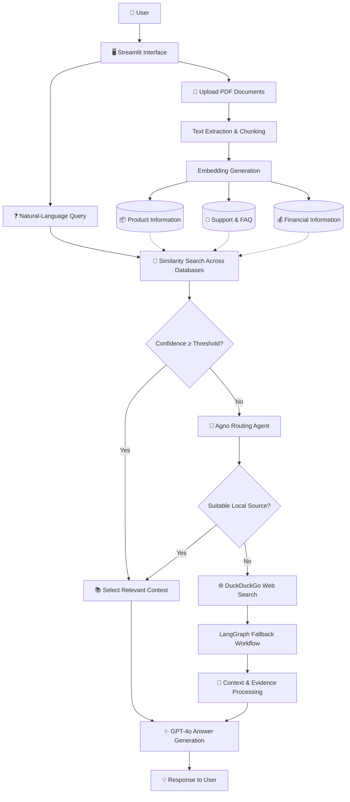

 <div align="center">


<br/>

[](https://www.python.org/)
[](https://streamlit.io/)
[](https://www.langchain.com/)
[](https://qdrant.tech/)
[](https://openai.com/)

<br/>

**An agentic Retrieval-Augmented Generation system that intelligently routes questions to specialized knowledge bases and falls back to web research when local knowledge isn't enough.**

[Explore the Project](#-project-overview) · [Architecture](#-system-architecture) · [Installation](#-installation--setup) · [Connect](#-connect-with-me)

</div>

---

## 🧠 Project Overview

Imagine a customer-service AI that needs to answer questions about products, troubleshooting, and financial information. Storing every document in one vector database can make retrieval less targeted and introduce irrelevant context.

**Intelligent RAG with Database Routing** addresses this challenge by separating information into specialized knowledge bases and selecting the most relevant source for each user query. Instead of treating every document as equally relevant, the application combines similarity-based retrieval, LLM-powered routing, and a web-search fallback to build a more context-aware question-answering workflow.

<div align="center">

| 🔴 Problem Statement | 🔵 Approach | 🟢 Findings |
|:---:|:---:|:---:|
| A single knowledge store can mix unrelated documents, creating noisy retrieval and irrelevant context. | Separate vector databases, similarity-based routing, an intelligent routing agent, and web-search fallback. | Specialized knowledge sources provide a structured retrieval strategy, while fallback search helps handle questions outside the available local knowledge. |

</div>

### 🔴 Problem Statement

Traditional RAG pipelines commonly retrieve information from a shared document collection. When product documentation, support FAQs, and financial records are mixed together, the system may retrieve information that is only loosely related to the user's question.

Key challenges include:

- **Mixed knowledge domains:** Different types of information compete within a shared retrieval space.
- **Irrelevant context:** Low-relevance documents can dilute the evidence used to generate an answer.
- **Ambiguous queries:** A question may not clearly identify the appropriate knowledge domain.
- **Limited knowledge coverage:** Uploaded documents cannot answer every possible question.
- **Uncertain answers:** Responses should reflect the relevance and availability of retrieved information.

### 🔵 Approach

The application uses a multi-stage, agent-assisted RAG architecture.

1. **Document ingestion:** Extract text from uploaded PDF files and prepare it for retrieval.
2. **Text chunking:** Divide documents into manageable, overlapping chunks to preserve useful context.
3. **Embedding generation:** Convert chunks into vector representations for semantic similarity search.
4. **Specialized storage:** Organize embeddings across three knowledge domains:
   - Product Information
   - Customer Support & FAQ
   - Financial Information
5. **Intelligent routing:** Compare retrieval relevance and use a GPT-4o-powered routing agent when confidence is insufficient.
6. **Context-aware generation:** Generate an answer using the selected source's retrieved context.
7. **Web-search fallback:** Use DuckDuckGo through a LangGraph-based fallback workflow when relevant local documents cannot adequately answer the question.

### 🟢 Findings

The architecture demonstrates several important design principles:

- **Domain separation:** Specialized collections make the intended knowledge boundaries explicit.
- **Confidence-aware retrieval:** A similarity threshold can help distinguish stronger matches from uncertain ones.
- **Agent-assisted decisions:** An LLM router can help resolve queries that similarity scores alone do not confidently classify.
- **Graceful fallback:** Web research offers an alternative when the local document collection lacks relevant evidence.
- **Modular orchestration:** LangChain, Agno, LangGraph, Qdrant, and Streamlit serve distinct roles in the overall workflow.

> These are architecture-level findings, not measured performance claims. Actual routing accuracy, latency, and answer quality should be evaluated with a representative test set.

---

## ✨ Key Features

<details>
<summary><strong>🧭 Intelligent Query Routing</strong></summary>

The system uses a staged decision process to select an appropriate knowledge source.

- Semantic similarity search across specialized databases.
- A configurable confidence threshold, described in the project specification as `0.5`.
- LLM-powered routing for uncertain or ambiguous queries.
- A web-search fallback for questions that cannot be answered adequately from local documents.

The exact threshold behavior and routing implementation should be verified against the application code.

</details>

<details>
<summary><strong>📚 PDF Document Processing</strong></summary>

- Upload documents through a Streamlit interface.
- Extract textual content from PDFs.
- Split extracted text into overlapping chunks.
- Generate embeddings for semantic retrieval.
- Store and retrieve vector representations using Qdrant.

</details>

<details>
<summary><strong>🤖 Context-Aware Answer Generation</strong></summary>

- Retrieve relevant document chunks before generating a response.
- Use an LLM to synthesize answers from available context.
- Apply retrieval confidence when deciding how to proceed.
- Use web research as a fallback for uncovered topics.

</details>

<details>
<summary><strong>🌐 Web Research Fallback</strong></summary>

When the local knowledge bases do not provide sufficient relevant information, the fallback workflow uses DuckDuckGo search, orchestrated through LangGraph, to gather additional information.

Web results should be treated as external evidence rather than as verified facts automatically.

</details>

<details>
<summary><strong>🖥️ Interactive Streamlit Interface</strong></summary>

Streamlit provides the application interface for uploading documents, submitting natural-language questions, and interacting with the RAG workflow.

</details>

---

## 🏗️ System Architecture

The application follows a retrieval-first architecture with an intelligent routing stage and an external research fallback.



### 🔄 Query Lifecycle

| Stage | Operation | Purpose |
|---|---|---|
| 01 | Query submission | Accept a question in natural language. |
| 02 | Similarity retrieval | Search the specialized vector databases for relevant content. |
| 03 | Confidence evaluation | Determine whether retrieval is sufficiently reliable. |
| 04 | Agent routing | Resolve uncertain routing decisions when required. |
| 05 | Fallback research | Search the web when suitable local information is unavailable. |
| 06 | Answer synthesis | Generate a response from the available evidence. |
| 07 | Response delivery | Display the answer through the Streamlit interface. |

---

## 🧰 Technology Stack

| Technology | Role in the Project |
|---|---|
| **Python** | Core application logic and orchestration |
| **Streamlit** | Interactive web interface |
| **LangChain** | Document processing, retrieval, and RAG orchestration |
| **Agno** | Agent-based routing decisions |
| **LangGraph** | Orchestration of the web-search fallback workflow |
| **Qdrant** | Vector storage and similarity retrieval |
| **OpenAI GPT-4o** | Routing assistance and answer synthesis |
| **DuckDuckGo Search** | External information retrieval when local knowledge is insufficient |
| **Embeddings** | Semantic representation of document chunks |

---

## 🗂️ Knowledge Base Design

### 📦 Product Information

Designed for questions about product descriptions, specifications, features, and related documentation.

**Example:** “What features does this product support?”

### 💬 Customer Support & FAQ

Designed for troubleshooting documentation, common questions, support instructions, and frequently encountered issues.

**Example:** “How can I troubleshoot this problem?”

### 💰 Financial Information

Designed for financial documents and related information contained in uploaded source material.

**Example:** “What does the uploaded financial report say about expenses?”

These are logical knowledge domains. Their exact Qdrant collection names and configuration should match the implementation.

---

## ⚙️ How the Routing Strategy Works

### Stage 1 — Similarity-Based Retrieval

The application searches the available vector databases for semantically relevant document chunks. Similarity scores help assess how closely retrieved content matches the user's query.

A threshold of `0.5` is described in the project specification. Its meaning depends on the score type and implementation; it should be calibrated and tested rather than assumed to represent a universal confidence probability.

### Stage 2 — Agent-Assisted Routing

When retrieval confidence is insufficient, the routing agent can evaluate the query and determine which knowledge domain is the best fit.

This is useful when the wording of a question is ambiguous or when several knowledge domains appear relevant.

### Stage 3 — Web-Search Fallback

If the local knowledge bases do not contain enough relevant information, the fallback workflow can use DuckDuckGo to retrieve external material.

This approach expands potential coverage beyond uploaded documents. External information should still be assessed for relevance, reliability, and freshness.

---

## 🚀 Installation & Setup

### Prerequisites

- Python installed on your system.
- Git installed.
- An OpenAI API key with access to the configured model.
- Access to a Qdrant instance or a supported local Qdrant configuration.
- The project source code and its dependency list.

### 1. Clone the Repository

```bash
git clone https://github.com/keshavkapill/A-RAG-agent-with-database-routing.git
cd A-RAG-agent-with-database-routing
```

### 2. Create a Virtual Environment

**Windows — Command Prompt**

```cmd
python -m venv venv
venv\Scripts\activate
```

**macOS / Linux**

```bash
python3 -m venv venv
source venv/bin/activate
```

### 3. Install Dependencies

If the repository contains a `requirements.txt` file, install the specified dependencies:

```bash
python -m pip install -r requirements.txt
```

If the dependency file is missing, inspect the source imports and project documentation before installing the required packages individually.

### 4. Configure Environment Variables

Create a local `.env` file if the application uses environment-based configuration.

Example template:

```dotenv
OPENAI_API_KEY=your_openai_api_key
QDRANT_URL=your_qdrant_url
QDRANT_API_KEY=your_qdrant_api_key
```

Replace these example values with the credentials and settings required by your implementation. If the application uses a local Qdrant instance, its configuration may differ.

**Security:** Never commit real API keys, tokens, passwords, or private environment files to GitHub. Add `.env` to `.gitignore`.

### 5. Launch the Application

Run the following command from the project root directory:

```bash
streamlit run rag_database_routing.py
```

Once Streamlit starts, open the local URL displayed in your terminal.

---

## 🧪 Example Usage

The following examples illustrate intended behavior; they are not recorded outputs from a verified execution.

| User Question | Expected Routing Intent |
|---|---|
| “What are the product specifications?” | Product Information |
| “How do I resolve this support issue?” | Customer Support & FAQ |
| “Summarize the financial information in my documents.” | Financial Information |
| “Find current information about a topic absent from my uploaded documents.” | Web-search fallback, when local retrieval is insufficient |

### Typical Workflow

1. Launch the Streamlit application.
2. Upload documents relevant to each knowledge domain.
3. Allow the application to extract, chunk, embed, and store document content.
4. Enter a natural-language question.
5. Let the routing workflow select an appropriate source.
6. Review the generated response and its supporting information, where available.

---

## 📈 Evaluation & Findings

A robust evaluation should test more than whether the application produces an answer. It should measure whether the system chooses the correct source and generates a response supported by evidence.

| Evaluation Area | What to Measure |
|---|---|
| Routing accuracy | Percentage of queries routed to the intended knowledge domain |
| Retrieval relevance | Relevance of retrieved chunks to the query |
| Answer faithfulness | Whether answers are supported by retrieved evidence |
| Fallback behavior | Whether unsupported local queries trigger appropriate web research |
| Response latency | Time required for retrieval, routing, and generation |
| Error handling | Behavior when documents, APIs, or databases are unavailable |

### Suggested Test Scenarios

- Questions with clear product, support, or financial intent.
- Ambiguous questions requiring agent-assisted routing.
- Queries whose answers are absent from all local databases.
- Queries with overlapping information across domains.
- Empty uploads, unreadable PDFs, and unavailable external services.

No numerical performance results are reported here because benchmark measurements have not been provided.

---

## 📁 Project Structure

The exact repository structure should be verified against the source code. A conceptual structure for this application could look like this:

```text
A-RAG-agent-with-database-routing/
│
├── rag_database_routing.py  # Streamlit application entry point
├── requirements.txt        # Python dependencies, if present
├── .env                    # Local credentials; do not commit
├── .gitignore
├── README.md
│
└── Additional modules       # If present in the actual project
```

---

## 🔐 Limitations & Considerations

- **Retrieval quality:** Results depend on document quality, chunk size, embedding choice, and search configuration.
- **Routing threshold:** A threshold that works for one dataset may not generalize to another.
- **LLM variability:** Agent decisions and generated answers can vary across queries and model configurations.
- **External sources:** Web-search results may be outdated, incomplete, or unreliable.
- **Operational cost:** Embedding generation, LLM calls, and external searches can introduce cost and latency.
- **Data privacy:** Sensitive documents should be handled according to the requirements of the selected storage and model providers.
- **Financial information:** Responses involving financial documents should be checked against the original source material.

---

## 🔮 Future Improvements

- [ ] Add a routing evaluation dataset with expected source labels.
- [ ] Measure precision, recall, routing accuracy, and end-to-end latency.
- [ ] Add document citations and source references to generated answers.
- [ ] Introduce caching for repeated queries and embedding operations.
- [ ] Add structured logging for retrieval scores and routing decisions.
- [ ] Improve handling of scanned PDFs and documents containing tables.
- [ ] Add tests for API failures, empty collections, and ambiguous queries.
- [ ] Provide a configurable routing threshold through the application interface.
- [ ] Add Docker-based deployment and automated testing.
- [ ] Improve the interface with retrieval transparency and source attribution.

---

## 🧠 Skills Demonstrated

- Retrieval-Augmented Generation (RAG)
- Semantic search and vector databases
- LLM agents and query routing
- Document ingestion and text chunking
- Context-aware answer generation
- Workflow orchestration and fallback design
- Python application development
- Interactive AI application development

---

## 👨‍💻 Connect With Me

<div align="center">

### Keshav Kapil

**Computer Science Engineering | Software Development | AI & Data Applications**

I enjoy building practical applications that combine software engineering, intelligent retrieval, and modern AI technologies to solve real-world problems.

<a href="https://github.com/keshavkapill">

</a>

<a href="https://www.linkedin.com/in/keshavkapil15">

</a>

</div>

---

## ⭐ Support

If you find this project interesting, consider giving the repository a star. Feedback, suggestions, and constructive contributions are welcome.

<div align="center">

<a href="https://github.com/keshavkapill/A-RAG-agent-with-database-routing">

</a>

<br/><br/>


**Made with 💜 by [Keshav Kapil](https://github.com/keshavkapill)**

<sub>Intelligent retrieval. Context-aware answers. Smarter routing.</sub>

</div>
